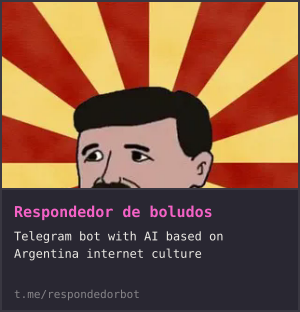
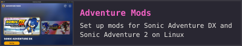
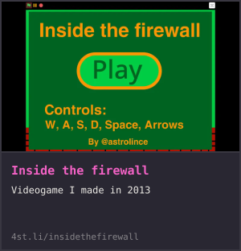
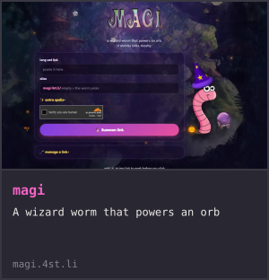
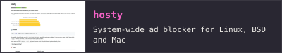
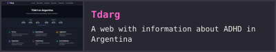
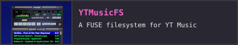

<!-- LINKS:START -->

<!-- LINKS:END -->

<!-- PROJECTS:START -->

<!-- PROJECTS:END -->

<!-- BLOG-POST-LIST:START -->
- [Recovering a TRON wallet with an Android exploit and brute force](https://4st.li/blog/tronlink-wallet-recovery/) 2026-03-22
- [Don&#39;t invest in yourself](https://4st.li/blog/invertir-en-vos/) 2024-05-12
- [Run, Think, Shoot, Live](https://4st.li/blog/half-life/) 2022-05-18

<!-- BLOG-POST-LIST:END -->

